# 🚀 HybridBox — Turn Any Broken-Screen Android Phone into a 3-in-1 TV Box, Linux PC & Retro Game Console

[](LICENSE)
[-amber)](#%EF%B8%8F-project-status-testing-phase--built-with-ai)
[-blue)](#-tested-hardware--universal-android-compatibility)
[](#-tested-hardware--universal-android-compatibility)

> 🌍 **Documentation**: [📖 Full Technical Guide (English)](docs/DOCUMENTATION.md) | [🇧🇷 Documentação Completa (Português)](docs/DOCUMENTACAO_COMPLETA_PT_BR.md)

**HybridBox** is an open-source, self-hosted **FastAPI + WebSocket + Progressive Web App (PWA)** platform designed to **rescue and upcycle smartphones with a broken screen (`screen broken` / `broken phone`)**—or any old Android phone/gadget sitting in a drawer—and transform it into a headless **3-in-1 Hybrid Living-Room Console** controlled entirely from your main smartphone's browser:

1. 📺 **Smart TV Box & Wireless Projector Hub**: Runs *Projectivy Launcher*, *SmartTube* (YouTube TV), *Stremio*, and *Kodi* in locked 1080p landscape on any **Projector** or **Smart TV** (via Wireless Miracast/Cast, DLNA, or USB-to-HDMI DisplayLink cable).
2. 🐧 **Full Linux XFCE4 Desktop (with Passwordless `sudo`)**: Runs a desktop Linux environment (`Termux:X11` + `XFCE4` + `Debian PRoot`) with Firefox, Thunar File Manager, a multi-touch trackpad with anti-jitter filtering, Web SSH Terminal, and a smart **`sudo`** wrapper so you can install any Linux software (`sudo apt install ...`).
3. 🎮 **Retro Gaming Console**: Includes a visual cover gallery to launch **Super Nintendo (SNES)**, **NeoGeo / Arcade (MAME)**, and **Sega Mega Drive (Genesis)** ROMs directly onto your TV or **Projector** in landscape, while turning your smartphone screen into a low-latency tactile gamepad (or pairing Bluetooth controllers).

---

## 📸 Live App Portals in Action (Real Screenshots)

All screenshots below were captured directly from the live **HybridBox Remote PWA** (`http://hybridbox.local:8080`) connected in real time to our broken-screen **Xiaomi Redmi Note 8 Pro (`begonia`)**:

### 1. 📺 TV Box Portal & 🚀 System Quick Launcher
Control *Projectivy Launcher*, *SmartTube*, *Stremio*, *Kodi*, and wireless **Projector** casting with an ergonomic D-Pad, media playback deck, and 1-tap app launcher drawer:

| 📺 TV Portal (D-Pad & Media Deck) | 🚀 System Quick Launcher Drawer |
| :---: | :---: |
| 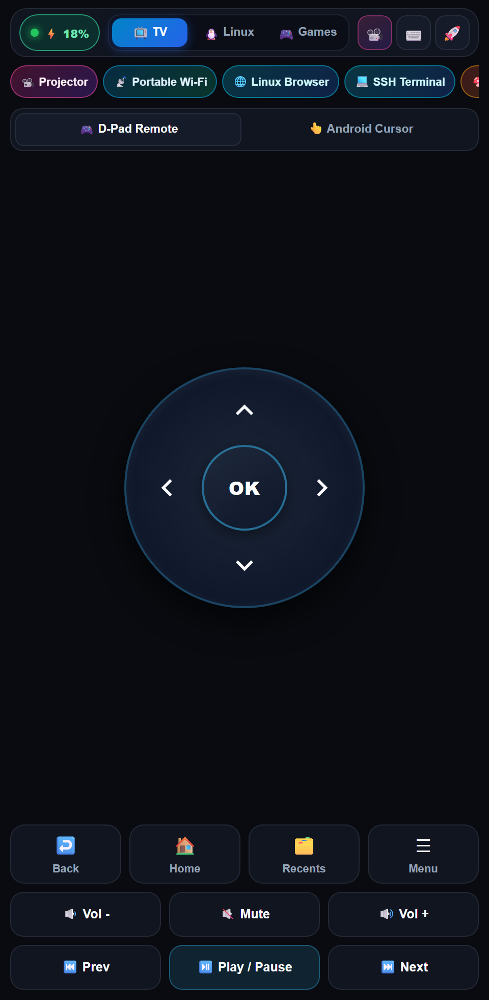 | 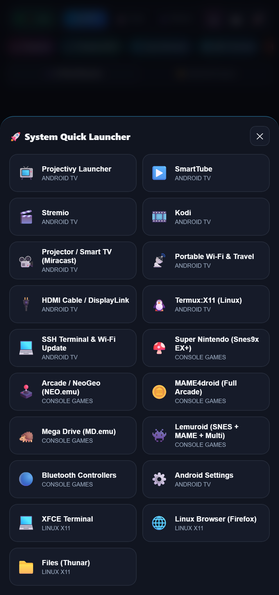 |

### 2. 🐧 Linux XFCE4 Portal (Multi-Touch Trackpad & Web SSH Terminal with `sudo`)
Navigate the full **Termux:X11 + XFCE4** desktop with a multi-touch anti-jitter trackpad, desktop macro keys, virtual keyboard bar, and a built-in **Web SSH Terminal** with passwordless **`sudo`** (`sudo apt install ...`):

| 🖱️ Linux X11 Multi-Touch Trackpad & Keyboard | 💻 Web SSH Terminal (`sudo` in Action) |
| :---: | :---: |
| 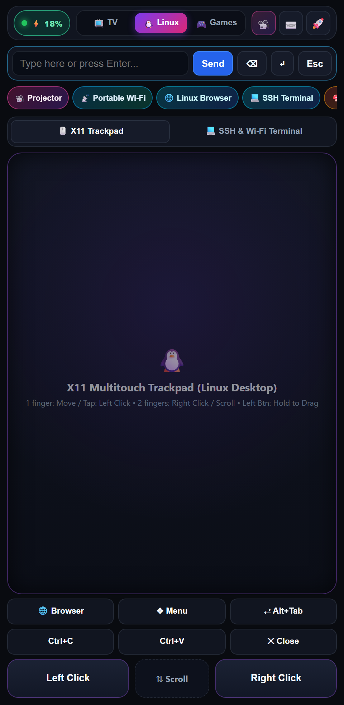 | 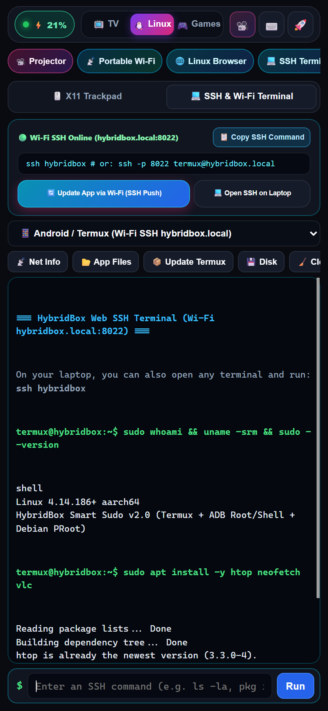 |

### 3. 🎮 Retro Gaming Portal (Visual Cover Gallery, Tactile Controllers & Multiplayer)
Browse **53+ SNES, NeoGeo/Arcade, and Sega Mega Drive** ROM covers to launch games directly onto your TV or **Projector** in full-screen landscape, and play using realistic tactile controller skins (or up to 4 players over Wi-Fi / Bluetooth):

| 📚 Visual ROM Cover Library (SNES, NeoGeo, Mega Drive) | 🍄 Tactile Super Nintendo Controller (Portrait) | 🎮 Controllers, Skins & Multiplayer (P1–P4) |
| :---: | :---: | :---: |
| 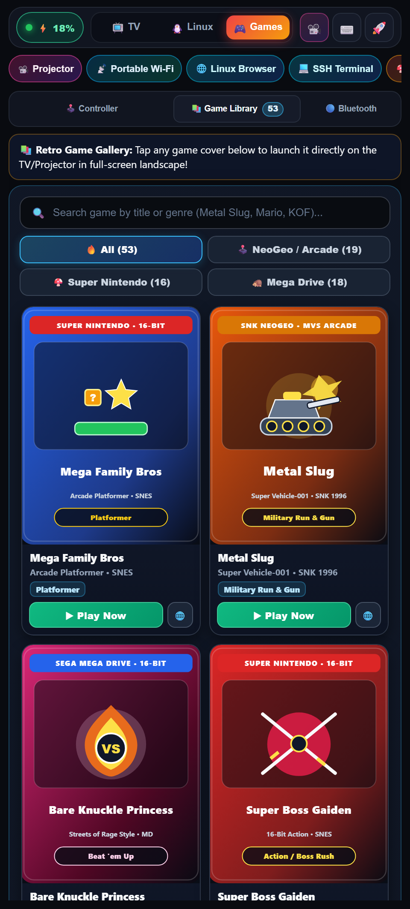 | 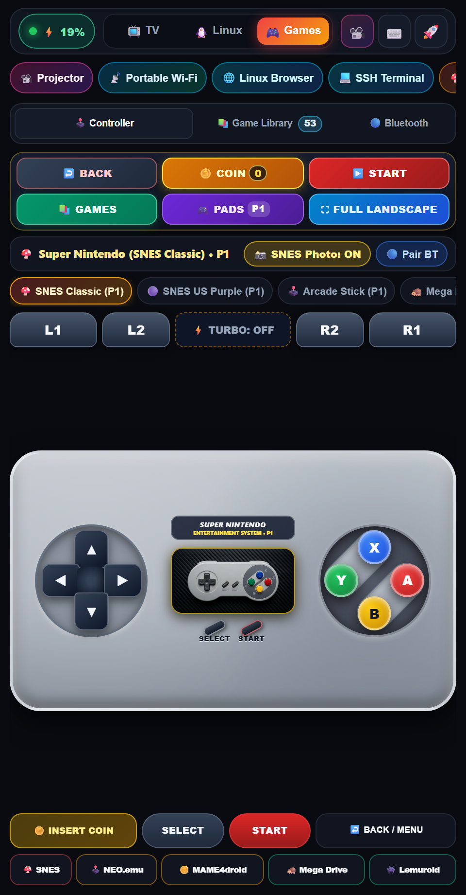 | 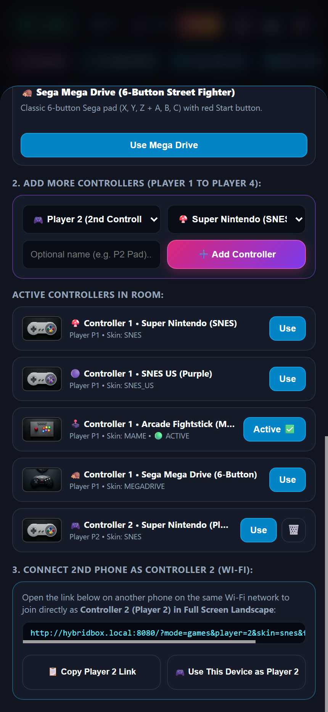 |

#### 🕹️ Full-Screen Landscape Arcade / NeoGeo 6-Button Fightstick HUD
<p align="center">
  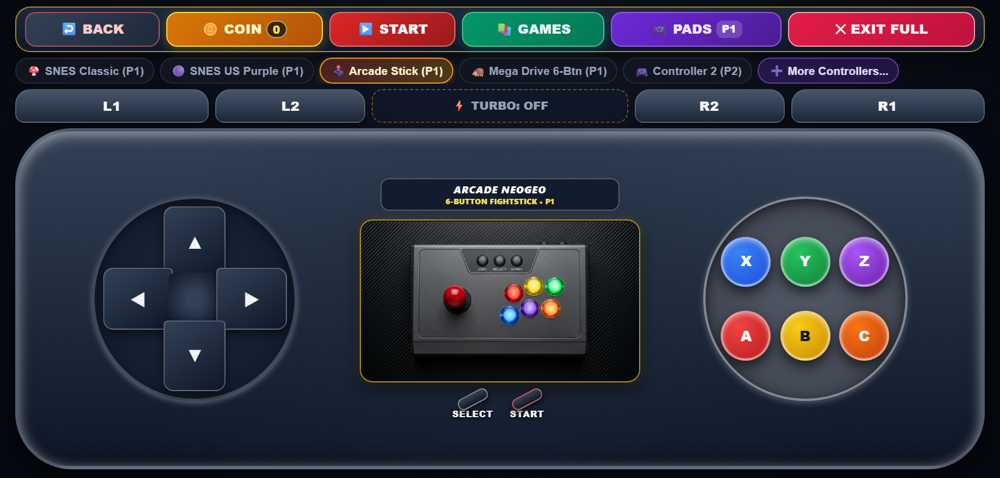
</p>

### 4. 📽️ Any TV / Projector, 📡 Portable Travel Wi-Fi & 🔋 0% Battery Recovery
Zero-touch wireless **Projector** (Miracast / DLNA / HDMI DisplayLink) auto-connection, **Portable Travel Wi-Fi** with automatic **Rescue Hotspot (`HybridBox` / `hybridbox123`)**, and live Xiaomi battery telemetry with **Plug & Revive** instructions:

| 📽️ Any TV or Projector Auto-Connect | 📡 Portable Wi-Fi & Rescue Hotspot | ⚡ Live Battery & 0% Recovery Guide |
| :---: | :---: | :---: |
| 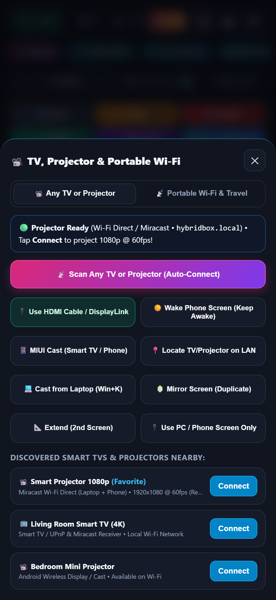 | 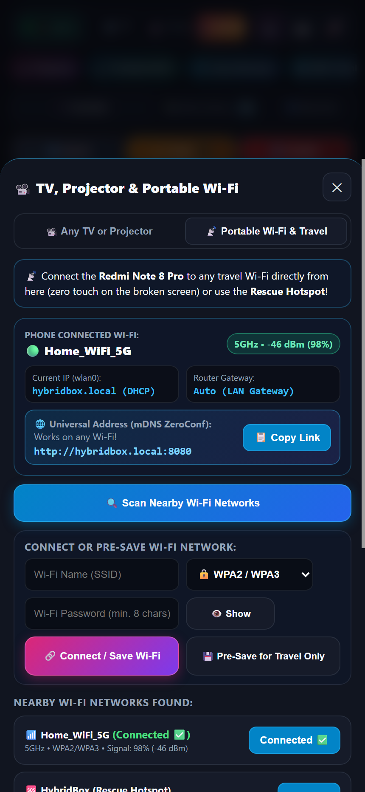 | 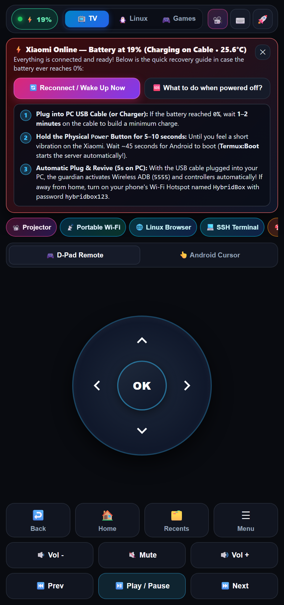 |

---

## ⚠️ Project Status: Testing Phase & Built with AI

- 🧪 **Testing Phase (Beta) — Suggestions Welcome!**: This project is currently in an active **testing phase**. If you have ideas, hardware compatibility reports, bug fixes, or feature suggestions, please open an [Issue](https://github.com/mfelisberto90/hybridbox/issues) or submit a Pull Request! Every suggestion is super welcome.
- 🤖 **Built with AI (Personal Open-Source Project)**: No secrets here—this is a **personal project built with the help of Artificial Intelligence (AI pair-programming)** to solve a real-world hardware problem at home, and I am making the entire codebase, scripts, and documentation freely available under the **MIT License** so anyone can reuse, learn from, or improve it.

---

## 🎯 Why HybridBox? (Purpose of the Project)

Every year, millions of powerful smartphones are thrown away or left forgotten in drawers because of a **broken screen (`screen broken`)**, cracked glass, black OLED panel, or a damaged touch digitizer firing "ghost touches" on its own—even though the phone's Octa-Core processor, 4GB–8GB RAM, Wi-Fi, and Bluetooth still work like new.

The goal of **HybridBox** was to take a **Xiaomi Redmi Note 8 Pro with a broken screen** and turn it into something genuinely useful without spending money on a screen replacement. Even better: **this exact setup works on any Android phone, tablet, or gadget** (Samsung, Xiaomi, Redmi, readMi, Motorola, OnePlus, Asus, Pixel, or generic Android TV Boxes).

---

## 📱 Tested Hardware & Universal Android Compatibility

### 🏆 Primary Device Tested
- **Model**: **Xiaomi Redmi Note 8 Pro** (codename `begonia`)
- **CPU / RAM**: MediaTek Helio G90T Octa-Core / 6 GB RAM / 128 GB UFS 2.1
- **OS**: Android 11 / MIUI 12.5 (**Unrooted**)
- **Screen Condition**: Broken screen with a damaged capacitive digitizer (`NVTCapacitiveTouchScreen` on `/dev/input/event2`) firing 60Hz ghost touches.
- **Video Output Tested**: Wireless **Projector** (`1920x1080 @ 60fps` via Miracast / Wi-Fi Direct), Smart TVs, and USB DisplayLink HDMI cable.

### 🌐 Works on Any Android Phone or Gadget
You do **not** need a Xiaomi phone or root access. HybridBox uses standard Android `ADB Loopback` (`uid=2000 shell`) and `Termux`, making it compatible with **any Android 8.0+ device**:
- **Samsung Galaxy** (`S8`, `S9`, `S10`, `S20`, `S21`, `S22`, `S23`, `Note`, `Galaxy A`, `Galaxy Tab` — works via Wireless Smart View / Miracast and USB-C HDMI / DeX)
- **Xiaomi / Redmi / readMi / POCO** (`Redmi Note 7`, `8`, `8 Pro`, `9`, `10`, `11`, `12`, `13`, `Poco X3`, `Mi 9`, `Mi 10`, `Mi 11`)
- **Motorola** (`Moto G`, `Moto Edge`, `Moto One`), **OnePlus**, **Google Pixel**, **Asus Zenfone / ROG**, **Realme**, **OPPO**, and **Android TV Sticks/Boxes**.

---

## 🛠️ How We Did It & How It Works (Step-by-Step Engineering)

Turning a phone with a broken screen into a zero-touch console required solving several real-world Android & Linux obstacles. Here is **how we did it**:

1. **Kernel-Level Ghost-Touch Blocker (`scripts/grab_ghost_touch.c`)**:
   - Cracked screens often send continuous phantom touches that click random buttons. Because Android's `adb shell` user (`uid=2000`) belongs to the `input` group (`gid=1004`), we wrote a lightweight C daemon (`grab_ghost_touch.c`) that opens `/dev/input/event2` (`NVTCapacitiveTouchScreen`), releases all stuck multi-touch slots (`ABS_MT_TRACKING_ID = -1`), and calls `ioctl(fd, EVIOCGRAB, 1)`.
   - This **blocks 100% of physical ghost touches** from the broken screen at the Linux kernel level while keeping synthetic touches (`input tap`), Bluetooth gamepads, and X11 mouse control working at 100%!
2. **Sub-5ms Privileged Android Bridge Without Root (`backend/HybridBoxBridge.java`)**:
   - Running a new `adb shell` process per button press has ~200ms latency. We wrote `HybridBoxBridge.java` (compiled to `backend/hybridbox_bridge.jar`), which runs via `/system/bin/app_process` on port `5558` as `uid=2000 (shell)`. It holds a permanent system `PARTIAL_WAKE_LOCK` via `IPowerManager` and executes shell commands in `<5ms` via `scripts/hb-shell`.
3. **24/7 Twin Watchdogs (`scripts/keep_awake.sh` & `scripts/hb_system_watchdog.sh`)**:
   - Prevents Android 11+ *Phantom Process Killer*, *Doze Mode*, and *MIUI Battery Saver* from ever killing Termux, OpenSSH (`8022`), Termux:X11 (`:0`), or the FastAPI server (`8080`). When unplugged from power, it automatically turns the broken screen's physical backlight down to `0` to save battery while keeping wireless projection running.
4. **Hands-Free Connection to Any TV or `Projector` (`backend/projector_controller.py`)**:
   - Tapping **"📡 Scan Any TV or Projector"** in the PWA wakes the display pipeline, opens Android's Wireless Display / Miracast settings, reads the screen list via `uiautomator dump`, taps your **Projector** or **Smart TV** automatically, and auto-confirms the *"Start now / Accept"* dialog without touching the phone.
5. **Portable Travel Wi-Fi, mDNS (`http://hybridbox.local:8080`), Zero-Config Auto-Discovery & Rescue Hotspot**:
   - **100% Zero-Config Auto-Discovery (No Hardcoded IPs, MACs, or Usernames)**: Whether you run HybridBox directly on the phone or from a PC, `AndroidController` automatically discovers your phone's IP and Termux SSH username (`u0_a...`) in `<1s` via: (1) native `wlan0` interface lookup inside Termux, (2) gitignored local runtime cache (`.hybridbox_runtime.json`) and `~/.ssh/config` (`Host hybridbox`), (3) USB/TCP ADB inspection, (4) multicast mDNS (`hybridbox.local`), and (5) a fast 96-worker parallel `/24` LAN & Hotspot subnet scanner on ports `8022` and `5555`.
   - **Automatic Rescue Hotspot**: If you take the phone to a new place and it has no Wi-Fi for 20 seconds, it automatically looks for a Wi-Fi hotspot named **`HybridBox`** (password **`hybridbox123`**) on your main phone and connects to it automatically!
6. **0% Battery Auto-Revive (`scripts/pc_usb_autorevive.py` + `Termux:Boot`)**:
   - If the phone battery drains to `0%` and shuts down, `Termux:Boot` auto-starts the services on power-up, and plugging it into a PC running `iniciar_hybridbox_pwa.bat` (or `pc_usb_autorevive.py`) automatically injects your PC's SSH public key (`~/.ssh/id_ed25519.pub`), re-enables `adb tcpip 5555`, and revives all daemons in seconds.

---

## 🐧 Installing Any Linux App via `sudo`

In the **🐧 Linux** mode (`Termux:X11` + `XFCE4` + `Debian PRoot`), HybridBox configures a smart **passwordless `sudo`** command (`/data/data/com.termux/files/usr/bin/sudo` via [`scripts/hb-sudo`](scripts/hb-sudo)).

You can open **XFCE Terminal** on the TV/Projector or use the built-in **Web SSH Terminal** inside the PWA (`🐧 Linux` → `💻 SSH & Wi-Fi`) and install any Linux package using `sudo`:

```bash
# 1. Update package lists
sudo apt update && sudo apt upgrade -y

# 2. Install desktop apps (VLC, GIMP, LibreOffice, Inkscape, Audacity...)
sudo apt install -y vlc gimp libreoffice

# 3. Install CLI & developer tools
sudo apt install -y git curl wget htop neofetch tmux vim nodejs python3-pip clang

# 4. Launch any GUI Linux app directly on your TV or Projector screen (:0)
DISPLAY=:0 vlc &
DISPLAY=:0 gimp &
```

Need a package that only exists in upstream Debian ARM64 repositories? `sudo apt install <package>` automatically falls back to installing it inside the integrated **Debian PRoot** container, or you can enter a full Debian root shell anytime with:
```bash
sudo -i
```

---

## 📦 Easy Download & One-Click Installation

We packaged HybridBox so you can download and install it as easily as possible on Windows, Linux, macOS, or directly inside Termux on Android—with **zero manual IP or username configuration required**.

### Option 1: One-Click Installer from a Windows PC (Recommended for Broken Screens)
1. Enable **USB Debugging** on your Android phone and plug it into your PC via USB.
   *(Tip: If your screen is broken, plug a USB OTG mouse into the phone for 1 minute to enable USB Debugging once).*
2. Clone or download this repository:
   ```bash
   git clone https://github.com/mfelisberto90/hybridbox.git
   cd hybridbox
   ```
3. Double-click **`install.bat`** (or run `.\install.bat` in PowerShell/CMD; pass `--no-start` to provision without launching the server loop).
   - It automatically sets up the Python virtual environment, installs dependencies, detects your phone via ADB/Wi-Fi, injects your SSH key, installs the required APKs (`Termux`, `Termux:X11`, `Termux:Boot`, `Projectivy Launcher`, `SmartTube`, and retro emulators if placed in `apks/`), syncs all scripts, and opens the control center at `http://localhost:8080`!
   - Whenever you edit code on your PC later, run **`atualizar_via_wifi.bat`** (or `atualizar_via_wifi.bat --sync-only`) to push updates over Wi-Fi SSH (`8022`) and restart the phone's services automatically.

### Option 2: Universal One-Command Installer on Linux / macOS / Termux (`install.sh`)
Whether you are inside **Termux** directly on the Android phone OR on a **Linux / macOS** computer, simply run:
```bash
git clone https://github.com/mfelisberto90/hybridbox.git ~/hybridbox-remote-pwa
cd ~/hybridbox-remote-pwa
bash install.sh
```
- **If run inside Termux on Android**: It automatically runs `scripts/setup.sh` + `scripts/start.sh`, installing `termux-x11`, `xfce4`, `firefox`, `thunar`, `openssh`, `proot-distro` (Debian Bookworm), `hb-sudo` (`sudo`), `Termux:Boot`, and starting the FastAPI server on port `8080`.
- **If run on a Linux/macOS PC**: It creates `.venv`, provisions the connected Android phone via ADB/SSH, and starts the server (supports `--check` and `--no-start`).

### Step 3: Install the PWA on Your Main Phone
Open **`http://hybridbox.local:8080`** (or `http://<PHONE_IP>:8080`) in Chrome or Safari on your daily phone and tap **"Add to Home Screen"**.

### Running Automated Tests
```bash
python -m unittest discover -s tests -v
```

---

## 📂 Project Structure

```text
HybridBox/
├── backend/
│   ├── main.py                        # FastAPI server, REST API & low-latency WebSocket (/ws)
│   ├── android_controller.py          # Persistent ADB shell + HybridBoxBridge TCP client + Battery telemetry
│   ├── projector_controller.py        # Wireless Projector & Smart TV controller (Miracast, DLNA, HDMI DisplayLink)
│   ├── wifi_portable_controller.py    # Portable Wi-Fi manager, Rescue Hotspot & mDNS (hybridbox.local)
│   ├── bluetooth_gaming_controller.py # Retro Game Hub, ROM cover generator, Emulator launcher & Bluetooth pairing
│   ├── ssh_terminal_controller.py     # Web SSH Terminal & One-Click Over-the-Air Wi-Fi updater
│   ├── x11_controller.py              # Direct X11 (:0) pointer/keyboard injection via python-xlib & xdotool
│   ├── app_registry.py                # App catalog for Android TV, Linux XFCE4 Desktop & Retro Emulators
│   ├── HybridBoxBridge.java           # Privileged uid=2000 Java bridge (System WakeLock & fast shell daemon)
│   └── hybridbox_bridge.jar           # Pre-compiled DEX jar deployed to /data/local/tmp/
├── frontend/
│   ├── index.html                     # English PWA interface (TV D-Pad, AirMouse, Linux Trackpad, Gamepad, Modals)
│   ├── styles.css                     # OLED Dark Mode responsive UI with lock against accidental zoom/scroll
│   ├── app.js                         # WebSocket client, EMA anti-jitter cursor filter, haptic feedback & ROM gallery
│   ├── manifest.json                  # Standalone Web App Manifest
│   └── sw.js                          # Offline-ready Service Worker (v23)
├── scripts/
│   ├── setup.sh                       # Automated Termux + X11 + XFCE4 + Debian PRoot + sudo installer
│   ├── start.sh                       # Session initializer (Termux:X11 + XFCE4 + SSH + ADB + Uvicorn :8080)
│   ├── hb-sudo                        # Smart passwordless `sudo` wrapper for Termux, Debian PRoot & Android shell
│   ├── hb-shell                       # Sub-5ms client for the privileged HybridBoxBridge daemon (port 5558)
│   ├── keep_awake.sh                  # Termux 24/7 anti-sleep & auto-heal guardian
│   ├── hb_system_watchdog.sh          # Privileged uid=2000 system watchdog (Doze killer & Rescue Wi-Fi Hotspot)
│   ├── grab_ghost_touch.c             # Kernel evdev EVIOCGRAB blocker for broken/cracked touchscreens
│   ├── shield_x11_touch.py            # Detaches ghost touch pointers from the Termux:X11 server
│   └── pc_usb_autorevive.py           # Automatic 0% battery "Plug & Revive" daemon via USB/Wi-Fi
├── docs/
│   ├── DOCUMENTATION.md               # Complete Technical Documentation (English)
│   ├── DOCUMENTACAO_COMPLETA_PT_BR.md # Documentação Completa (Português)
│   └── screenshots/                   # Real high-resolution screenshots of all live PWA portals
├── install.bat                        # One-Click Windows Installer & Device Provisioner
├── install.sh                         # One-Command Linux / macOS / Termux Universal Installer
├── start_hybridbox.bat                # Quick launcher for Windows (English alias)
├── iniciar_hybridbox_pwa.bat          # Quick launcher for Windows (PT-BR)
├── atualizar_via_wifi.bat             # Over-the-Air Wi-Fi SCP sync & interactive SSH terminal
└── LICENSE                            # MIT License
```

---

## 🇧🇷 Resumo em Português (PT-BR)

> 📖 **Leia a documentação completa em português aqui**: [`docs/DOCUMENTACAO_COMPLETA_PT_BR.md`](docs/DOCUMENTACAO_COMPLETA_PT_BR.md)

- **Qual a finalidade do projeto?** Aproveitar um celular com **tela quebrada (`screen broken` / `broken phone`)** que ficaria parado na gaveta e transformá-lo em um **Console Híbrido 3-em-1** (📺 **Android TV Box / Projector**, 🐧 **Computador Linux Desktop XFCE4** e 🎮 **Vídeo Game Retrô**), podendo ser usado em **qualquer celular ou gadget Android** (Samsung, Xiaomi, Redmi, readMi, Motorola, etc.).
- **Com qual celular foi testado?** Testado de ponta a ponta em um **Xiaomi Redmi Note 8 Pro (`begonia`)** com a tela quebrada (bloqueando toques fantasmas no kernel via `EVIOCGRAB` sem precisar de root).
- **Posso instalar outros programas via `sudo` no Linux?** **Sim!** O modo Linux já vem com `sudo` sem senha configurado (`scripts/hb-sudo` + Debian via `proot-distro`). Basta abrir o terminal e rodar `sudo apt update && sudo apt install -y <programa>`.
- **Fase de Testes & Feito com IA**: Este é um **projeto pessoal desenvolvido com auxílio de Inteligência Artificial (IA)** e disponibilizado gratuitamente sob licença **MIT**. O projeto está em **fase de testes** e **aceito sugestões, ideias e melhorias!**

---

## 🏷️ Search Tags & Keywords (Tags para Busca)

`Samsung` • `Android` • `readMi` • `Redmi` • `Xiaomi` • `broken phone` • `screen broken` • `cracked screen` • `broken display` • `ghost touch fix` • `upcycling` • `reuse old phone` • `e-waste` • `Android TV Box` • `Projector` • `Miracast` • `DisplayLink` • `Linux on Android` • `Termux` • `Termux-X11` • `XFCE4` • `Debian PRoot` • `passwordless sudo` • `retro gaming console` • `SNES` • `NeoGeo` • `MAME` • `Mega Drive` • `PWA remote control` • `FastAPI` • `Redmi Note 8 Pro` • `begonia`

---

## 📄 License

Distributed under the **MIT License**. See [`LICENSE`](LICENSE) for full details.
